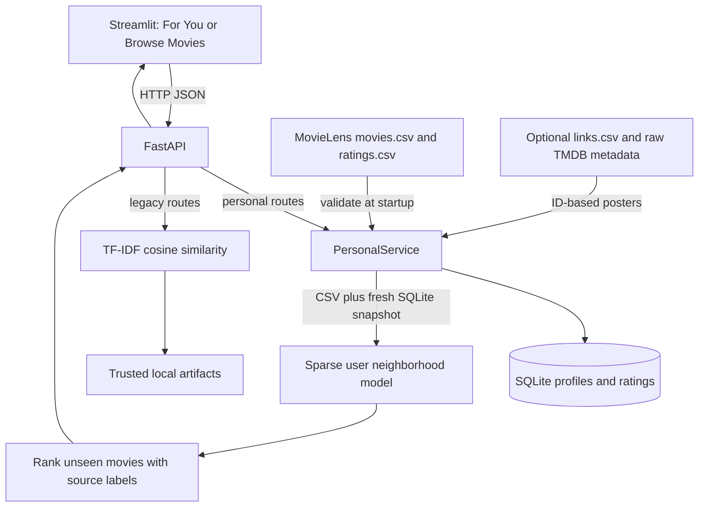

# System architecture

## Existing and updated application

The existing Python system uses a FastAPI backend and Streamlit frontend. `notebook/movies.ipynb` cleans original metadata, combines overview/genres/tagline, and fits a 50,000-feature TF-IDF vectorizer. Four trusted local pickles represent 45,447 metadata rows and sparse text features. Title lookup handles duplicate titles by choosing the first matching position. The original system has no user IDs, feedback store or evaluation; title similarity is identical for every viewer selecting a given title.

The upgrade adds a separate ID-safe MovieLens catalog, SQLite profiles and explicit ratings, and user-based collaborative filtering. Legacy browse, popular movies, detail pages and TF-IDF remain. No SPA, microservice or external database was introduced. FastAPI 0.111, Streamlit 1.36, pandas 2.2, NumPy 2, SciPy 1.13, scikit-learn 1.5 and requests remain the runtime stack; SQLite is Python standard library.



## Dataset and preprocessing

Official MovieLens latest-small: 100,836 ratings, 610 users, 9,742 catalog movies. The download script retains README/license and records archive SHA256 `696d65a3dfceac7c45750ad32df2c259311949efec81f0f144fdfb91ebc9e436`. See [GroupLens structure and license](https://files.grouplens.org/datasets/movielens/ml-latest-small-README.html). Research/development use and attribution are required; commercial use requires permission. Raw source data is ignored by Git.

Movie IDs must be finite positive integers; invalid/missing titles are removed and duplicate movie IDs keep the first. Ratings require numeric integer positive user IDs, known movie IDs, finite half-star values 0.5–5 and nonnegative integer timestamps. Invalid rows are dropped. Repeated user/movie pairs keep the latest timestamp (last source row wins equal timestamps). The official download retained all 100,836 ratings. Tags are retained in the download but are not used as ratings. Optional posters join `links.csv.tmdbId` to `Datset/movies_metadata.csv.id`; no title join is used. MovieLens IDs, TMDB IDs and legacy positional indices are distinct namespaces.

## Sparse interaction representation and scoring

CSR rows map sorted unique users; columns map sorted movie IDs. Values are observed ratings, with a separate observation mask. Structural zeros mean missing data, not negative feedback. Local users are internally offset by the maximum source user ID to avoid collisions.

Primary algorithm: user-based Pearson neighborhood CF, chosen because 610 users permit inexpensive, explainable per-viewer similarity without a dense item-by-item matrix or a factorization training pipeline. Pearson statistics are calculated only on shared observed ratings, with at least three shared movies and nonzero variance. Multiply correlation by `overlap / (overlap + 10)`, keep up to 40 positive neighbors, exclude self. Candidate predictions require at least two supporting neighbors:

`prediction(u,i) = mean(u) + sum(sim(u,v) * (rating(v,i) - mean(v))) / sum(sim(u,v))`

Means use each user's observed training history; clip predictions to 0.5–5. Unsupported candidates use `(item_sum + 10 * global_mean) / (item_count + 10)`. Each row is labeled `collaborative` or `popularity`; the response strategy is collaborative, popularity, mixed or empty. Both types share the estimated-rating scale and are sorted together. Ties break by rating count then movie ID. Filter all already-rated movies and candidates without rating evidence. New/constant-rating/sparse users gracefully fall back. Unknown source users are cold-start at engine level; HTTP requires an existing local profile.

The model is built from immutable startup CSV ratings plus a freshly read SQLite snapshot on every recommendation request. No persisted CF model file exists to become stale. Restart to reload replaced CSVs. This trades some CPU for simple, immediately updated local preferences at this dataset size. Legacy artifacts still load once. No automatic CSV download occurs at server startup.

## Database and update flow

`users(id INTEGER PRIMARY KEY AUTOINCREMENT, name TEXT)` stores nicknames (1–60 trimmed characters). `ratings(user_id, movie_id, rating, timestamp)` has a composite primary key, user foreign key, half-star range CHECK and Unix-seconds timestamp. Movie existence is checked against the loaded catalog in the service. Ratings are transactionally upserted; SQLite connections close after each operation. Stale local movie IDs are ignored when rebuilding the model; history labels them unavailable. Data is in ignored `data/preferences.sqlite3` by default. This is a shared local demonstration, without authentication.

User selects profile → searches MovieLens → saves rating via PUT → SQLite upsert → Streamlit rerun → GET recommendations → latest snapshot plus CSV → neighbors and ranked unseen movies → UI score/source labels. Profile switching uses native session state. Personal results are not cached, so edits apply immediately. Legacy lists and optional poster searches retain their existing cache.

## HTTP contract

Local FastAPI serves interactive OpenAPI at `/docs`. Streamlit calls it server-side using requests with timeouts. No frontend build system is required. The launcher waits up to 30 seconds for the backend health endpoint before starting Streamlit. Connection failures expose a retry action in For You.

| Method | Route | Request/response |
|---|---|---|
| GET | `/health` | status, total unique legacy titles, personal_ready, legacy_ready |
| GET | `/movies` | legacy total and title list |
| GET | `/movies/popular?n=60` | legacy movies; n 1–100 |
| GET | `/movie/{title}` | legacy metadata or 404 |
| POST | `/recommend` | `{movie,n}` → input metadata and TF-IDF recommendations |
| GET | `/personal/movies?q=&n=40` | `{movies:[{movie_id,title,genres,poster_url}],total}`; n 1–100 |
| GET | `/personal/users` | `{users:[{id,name}]}` |
| POST | `/personal/users` | `{name}` → `{id,name}`, HTTP 201 |
| GET | `/personal/users/{id}/ratings` | `{user_id,ratings:[{movie_id,rating,timestamp,title}]}` |
| PUT | `/personal/users/{id}/ratings` | `{movie_id,rating}` → saved user/movie/rating |
| GET | `/personal/users/{id}/recommendations?n=10` | `{user_id,strategy,neighbor_count,rated_count,recommendations}`; n 1–50 |

Personal recommendation rows contain movie_id, title, genres, poster_url, score (0.5–5), rating_count and source. Personal rows additionally expose tmdb_id for exact poster lookup. The frontend reuses raw metadata posters, verifies image bytes server-side and embeds them inline. It recovers missing/stale URLs through TMDB details by ID when a key is configured, otherwise uses a placeholder. Unknown legacy titles use exact title/year search, avoiding an arbitrary first search result. Poster requests have timeouts and five-minute caching, and grid loads use at most eight workers. IDs are validated, unknown profiles/movies return 404, malformed input returns 422. Standard error body is `{detail: ...}` (FastAPI validation detail can be a list). SQLite failures log internally and return actionable 503 without private paths. Missing CSVs or storage problems disable personal routes with 503; missing legacy artifacts disable only legacy routes. Health is degraded when either service is unavailable. UI shows loading, onboarding, empty and error states. Optional legacy poster lookups retain their existing quiet placeholder fallback.

## Evaluation

`scripts/evaluate.py` splits each user's ratings before constructing any model statistics: seed 42, 20% random holdout, retaining at least three train ratings. Both CF and popularity see identical training data. Catalog titles/IDs are known, but no held-out ratings, item counts, similarities or means are used. RMSE/MAE cover all held-out predictions, including labeled fallback. Top-10 metrics use full unseen train-rated catalog, held-out stars ≥4 as relevance, macro averaging over users with relevant holdouts. Actual results and configuration are in `reports/evaluation.json` and README.md. Ranking is weaker than popularity; no temporal validation or hyperparameter tuning claim is made.

## Complete project structure

```text
.
├── .gitignore
├── .env                         # existing private configuration, ignored
├── .venv/                       # local runtime, ignored
├── PRD.md
├── README.md
├── architecture.md
├── design.md
├── memory.md
├── rules.md
├── tasks.md
├── requirements.txt             # includes both component requirement files + httpx
├── run.sh                       # local two-process launcher, configurable ports
├── backend/
│   ├── __init__.py
│   ├── main.py                  # lifecycle, health, routers and error handlers
│   ├── collaborative.py         # validation, loading, sparse CF and baseline
│   ├── store.py                 # SQLite profiles and rating persistence
│   ├── model_loader.py          # legacy trusted artifacts and metadata cleanup
│   ├── schemas.py               # legacy and health Pydantic schemas
│   ├── utils.py                 # legacy title resolution and content similarity
│   ├── requirements.txt
│   └── routes/
│       ├── __init__.py
│       ├── personal.py          # personal API validation and orchestration
│       └── recommend.py         # preserved content API
├── frontend/
│   ├── app.py                   # Streamlit personal/browse/detail views
│   ├── posters.py               # local posters, ID lookup, verification and caching
│   └── requirements.txt
├── notebook/movies.ipynb         # original text preprocessing/training
├── scripts/
│   ├── download_movielens.py    # official archive setup and provenance
│   └── evaluate.py              # deterministic evaluation CLI
├── tests/
│   ├── test_recommendations.py  # hand-calculated engine, store and API tests
│   ├── test_ui.py               # real-data Streamlit/FastAPI journey
│   └── test_posters.py          # poster reuse, recovery, failure and matching tests
├── reports/evaluation.json      # executed real-data evaluation
├── Datset/movies_metadata.csv    # original raw metadata, ignored
├── pickle_files/                 # df, indices, tfidf, tfidf_matrix pickles, ignored
└── data/                        # ignored downloaded and private data
    ├── ml-latest-small/          # movies, ratings, links, tags, README, SOURCE
    └── preferences.sqlite3      # created when app starts normally
```

`.git`, caches and OS metadata are omitted. Deleted root app.py/main.py were already absent when work began and were not restored or replaced.
